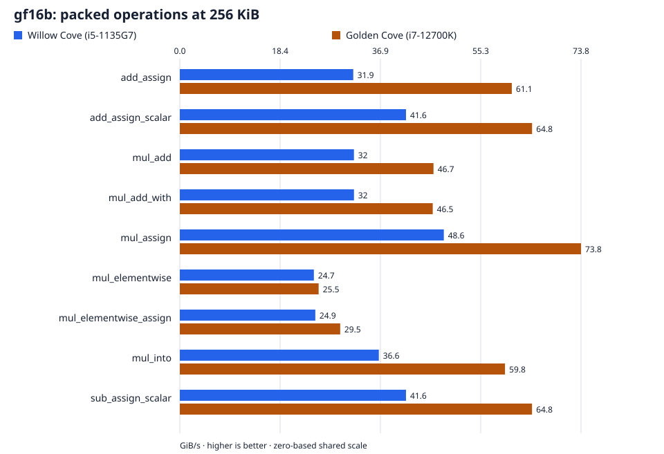

# Degree-16 fields: `gf16b`, `gf16d`

Every result cell reports **Willow Cove (i5-1135G7) / Golden Cove (i7-12700K)**. Throughput: higher is better. Latency: lower is better. A dash means no measurement.

[All families](../../BENCHMARKS.md) · [Field definitions](../labels.md)

## Find a result

- [Scalar multiplication](#scalar-multiplication)
- [Packed operations](#packed-operations)
- [Aligned single-row operations](#aligned-single-row-operations)
- [One-shot and prepared multiplication](#one-shot-and-prepared-multiplication)
- [Scatter, gather, and matrix](#scatter-gather-and-matrix)
- [Short multi-row operations](#short-multi-row-operations)
- [Row-wise addition](#row-wise-addition)
- [Row-wise addition compositions](#row-wise-addition-compositions)
- [Scatter destination alignment](#scatter-destination-alignment)
- [Large destinations](#large-destinations)
- [Single-row multiplication](#single-row-multiplication)
- [Competitors](#competitors)
- [Measurement details](#measurement-details)

## At a glance

Packed operations at **256 KiB**, ordinary buffers. Both hosts share a linear scale starting at zero. Exact figures and all measured sizes follow under Packed operations.

## Self-timings

### Scalar multiplication

Latency of the dependent multiply chain, per scalar operation.

| Field | Operation | scalar mul (ns/op) |
| --- | --- | --- |
| gf16b | scalar mul | 15.0 / 9.13 |
| gf16d | scalar mul | 17.3 / 10.3 |

### Packed operations

`gf16b`, ordinary `Vec<u8>` buffers.

| Operation | 4 KiB (GiB/s) | 256 KiB (GiB/s) | 8 MiB (GiB/s) |
| --- | --- | --- | --- |
| add_assign | 44.0 / 93.1 | 31.9 / 61.1 | 7.63 / 10.3 |
| add_assign_scalar | 40.8 / 74.4 | 41.6 / 64.8 | 28.4 / 24.6 |
| mul_add | 39.9 / 52.0 | 32.0 / 46.7 | 7.00 / 7.84 |
| mul_add_with | 40.1 / 52.4 | 32.0 / 46.5 | 6.88 / 7.84 |
| mul_assign | 56.1 / 80.5 | 48.6 / 73.8 | 28.8 / 30.6 |
| mul_elementwise | 31.4 / 33.6 | 24.7 / 25.5 | 4.70 / 4.89 |
| mul_elementwise_assign | 32.8 / 34.0 | 24.9 / 29.5 | 5.95 / 6.79 |
| mul_into | 48.3 / 74.7 | 36.6 / 59.8 | 6.89 / 9.17 |
| sub_assign_scalar | 41.3 / 74.7 | 41.6 / 64.8 | 28.5 / 24.5 |

### Aligned single-row operations

64-byte-aligned buffers.

| Operation | 64 KiB (GiB/s) |
| --- | --- |
| mul_add | 40.2 / 53.1 |
| mul_into | 36.0 / 61.1 |

### One-shot and prepared multiplication

Latency per call. The one-shot form derives the backend coefficient on every call; the prepared form reuses coefficients built outside the timed region.

| Field | Row size | mul_add (ns/op) | mul_add_with (ns/op) |
| --- | --- | --- | --- |
| gf16b | 16 B | 11.0506 / 5.19089 | 10.1178 / 4.56406 |
| gf16b | 32 B | 10.8356 / 5.16891 | 9.97984 / 4.49628 |
| gf16b | 64 B | 11.8746 / 5.57131 | 10.4940 / 4.91909 |
| gf16b | 128 B | 12.3711 / 6.40569 | 11.5213 / 5.76404 |
| gf16b | 256 B | 13.8780 / 7.79158 | 12.9475 / 7.27550 |
| gf16b | 512 B | 16.7720 / 11.9952 | 16.1497 / 11.5085 |
| gf16b | 1 KiB | 28.3436 / 19.6839 | 27.0819 / 18.9034 |
| gf16b | 2 KiB | 39.8096 / 35.5027 | 39.3032 / 34.5415 |
| gf16b | 4 KiB | 100.344 / 71.9117 | 99.5365 / 71.5969 |
| gf16b | 16 KiB | 357.697 / 273.229 | 355.731 / 276.235 |
| gf16b | 64 KiB | 1926.80 / 1315.43 | 1926.27 / 1314.67 |
| gf16d | 64 B | 245.132 / 127.922 | 247.655 / 129.372 |
| gf16d | 1 KiB | 3833.63 / 1968.92 | 3839.13 / 1968.31 |
| gf16d | 16 KiB | 61600.9 / 31443.3 | 61540.0 / 31391.4 |
| gf16d | 64 KiB | 248367 / 128063 | 248210 / 128018 |

### Scatter, gather, and matrix

64 KiB rows, ordinary `Vec<u8>` buffers. The column count is destinations for scatter and matrix, sources for gather.

| Operation | 2 rows (GiB/s) | 4 rows (GiB/s) | 8 rows (GiB/s) | 16 rows (GiB/s) |
| --- | --- | --- | --- | --- |
| mul_add_gather | 34.0 / 64.0 | 39.9 / 75.0 | 38.7 / 75.3 | 40.8 / 70.0 |
| mul_add_gather_with | 33.9 / 63.9 | 39.8 / 75.3 | 38.7 / 75.2 | 40.8 / 70.0 |
| mul_add_matrix | 46.6 / 48.3 | 56.7 / 54.8 | 56.7 / 55.6 | 56.8 / 55.6 |
| mul_add_matrix_with | 45.7 / 47.8 | 56.3 / 54.6 | 56.6 / 54.6 | 56.4 / 55.4 |
| mul_add_scatter | 31.1 / 54.5 | 27.1 / 57.7 | 27.5 / 60.6 | 27.2 / 35.7 |
| mul_add_scatter_with | 31.1 / 54.2 | 27.1 / 57.6 | 27.5 / 60.6 | 27.2 / 36.0 |

### Short multi-row operations

Sixteen rows, eight sources; coefficient sets include zeros and ones.

| Operation | 64 B (GiB/s) | 256 B (GiB/s) | 1 KiB (GiB/s) | 16 KiB (GiB/s) |
| --- | --- | --- | --- | --- |
| mul_add_gather | 7.42 / 14.9 | 20.0 / 37.6 | 32.6 / 54.8 | 38.7 / 70.6 |
| mul_add_matrix | 4.80 / 27.1 | 15.9 / 45.6 | 38.3 / 54.2 | 62.3 / 57.4 |
| mul_add_scatter | 6.35 / 12.7 | 17.9 / 34.1 | 32.8 / 64.2 | 39.7 / 64.2 |
| mul_into copy+scale | 3.92 / 5.98 | 13.0 / 20.1 | 21.3 / 39.3 | 39.7 / 58.3 |
| mul_into | 2.86 / 5.43 | 10.6 / 18.2 | 29.3 / 48.1 | 56.3 / 80.0 |

### Row-wise addition

`gf16b`; columns give the size of each row. Flat addition and the per-row loop use the same geometry.

| Operation | Rows | 64 B (GiB/s) | 1 KiB (GiB/s) | 64 KiB (GiB/s) |
| --- | --- | --- | --- | --- |
| add_assign_rows | 1 | 5.28 / 11.2 | 41.8 / 75.9 | 31.7 / 60.7 |
| add_assign_rows | 2 | 10.3 / 22.3 | 58.6 / 82.7 | 31.9 / 60.9 |
| add_assign_rows | 4 | 21.1 / 39.5 | 40.5 / 90.6 | 31.9 / 61.1 |
| add_assign_rows | 8 | 21.8 / 62.7 | 77.7 / 122 | 30.8 / 43.2 |
| add_assign_rows | 16 | 41.8 / 76.0 | 82.5 / 126 | 18.9 / 24.7 |
| add_assign_rows | 32 | 58.7 / 82.6 | 34.5 / 63.5 | 18.2 / 23.6 |

### Row-wise addition compositions

Show row-wise addition compositions

`gf16b`; columns give the size of each row. Flat addition and the per-row loop use the same geometry.

| Operation | Rows | 64 B (GiB/s) | 1 KiB (GiB/s) | 64 KiB (GiB/s) |
| --- | --- | --- | --- | --- |
| add_assign | 1 | 7.73 / 14.0 | 51.7 / 81.9 | 31.8 / 60.7 |
| add_assign | 2 | 14.3 / 26.6 | 71.1 / 90.6 | 32.0 / 60.9 |
| add_assign | 4 | 27.4 / 46.6 | 50.2 / 94.0 | 31.9 / 61.1 |
| add_assign | 8 | 30.5 / 71.0 | 80.8 / 127 | 30.8 / 43.0 |
| add_assign | 16 | 51.7 / 81.9 | 84.0 / 129 | 18.9 / 24.7 |
| add_assign | 32 | 72.0 / 91.0 | 34.9 / 64.2 | 18.2 / 23.6 |
| add_assign per row | 1 | 6.57 / 12.7 | 44.3 / 81.1 | 31.9 / 60.8 |
| add_assign per row | 2 | 7.27 / 13.3 | 52.2 / 83.6 | 31.9 / 60.5 |
| add_assign per row | 4 | 7.83 / 14.3 | 45.6 / 83.3 | 31.9 / 60.8 |
| add_assign per row | 8 | 8.15 / 14.9 | 55.8 / 99.5 | 30.7 / 43.0 |
| add_assign per row | 16 | 7.80 / 14.1 | 53.8 / 96.7 | 18.9 / 24.7 |
| add_assign per row | 32 | 8.14 / 13.8 | 34.1 / 62.4 | 18.1 / 23.6 |

### Scatter destination alignment

Show scatter destination alignment

Eight destinations, ordinary `Vec<u8>` source; the destination starts at the stated offset from a 64-byte boundary.

| Row size | Destination offset mod 64 | mul_add_scatter (GiB/s) |
| --- | --- | --- |
| 256 KiB | 0 | 26.3 / 23.9 |
| 256 KiB | 16 | 21.2 / 23.6 |
| 64 KiB | 0 | 29.4 / 63.4 |
| 64 KiB | 16 | 21.5 / 60.9 |

### Large destinations

Show large destinations

Ordinary `Vec<u8>` buffers. The read-back row XOR-folds every written 64-bit word after `mul_into`.

| Buffer size | mul_into (GiB/s) |
| --- | --- |
| 1 MiB | 18.3 / 23.2 |
| 32 MiB | 6.26 / 27.2 |
| 8 MiB | 8.07 / 40.0 |

### Single-row multiplication

256 KiB `mul_add`, ordinary `Vec<u8>` buffers. One byte volume means one information volume: the wider fields carry the same payload per call.

| Operation | mul_add (GiB/s) |
| --- | --- |
| mul_add | 30.1 / 46.7 |

## Competitors

Each arm runs its native field primitive; no codec operation substitutes for a field primitive. Tables split by the primitives each library exposes, so every column is populated. "Fixed" reuses one coefficient set; "Cycling" rotates through sixteen prepared sets.

| Arm | Native representation | Execution |
| --- | --- | --- |
| `gf16b` | AES-rooted quadratic tower; adjacent component bytes | Resolved field route |
| GF-Complete | Polynomial `0x1100B`; little-endian words | SSSE3 split-4/16 |
| reed-solomon-erasure | RS-rooted quadratic extension; big-endian components | Scalar GF16 |
| reed-solomon-simd | Cantor coordinates; tile-local low/high planes | AVX2 |
| Leopard-RS 1.x | Cantor coordinates; tile-local low/high planes | AVX2 |

Field maps and coefficient/layout conversions are validated and excluded from timing. Native encodings are not renamed `gf16d`.

### In-place scaling

| Operation | Sources × destinations | Row size | Coefficients | `fgf` (GiB/s) | GF-Complete (GiB/s) | `reed-solomon-simd` (GiB/s) |
| --- | --- | --- | --- | --- | --- | --- |
| dst = c * dst | 1 × 1 | 64 B | Cycling | 3.299 / 5.349 | 0.334 / 0.609 | 5.448 / 11.83 |
| dst = c * dst | 1 × 1 | 64 B | Fixed | 3.344 / 5.337 | 0.335 / 0.608 | 5.340 / 11.83 |
| dst = c * dst | 1 × 1 | 4 KiB | Cycling | 58.38 / 67.08 | 6.225 / 10.62 | 23.70 / 39.02 |
| dst = c * dst | 1 × 1 | 4 KiB | Fixed | 58.66 / 67.09 | 6.255 / 10.46 | 23.70 / 39.02 |
| dst = c * dst | 1 × 1 | 16 KiB | Cycling | 64.98 / 87.27 | 7.993 / 13.26 | 25.71 / 40.74 |
| dst = c * dst | 1 × 1 | 16 KiB | Fixed | 65.02 / 87.47 | 8.023 / 13.26 | 25.85 / 40.99 |
| dst = c * dst | 1 × 1 | 64 KiB | Cycling | 51.10 / 72.52 | 8.602 / 14.13 | 24.04 / 41.25 |
| dst = c * dst | 1 × 1 | 64 KiB | Fixed | 51.08 / 72.61 | 8.618 / 14.13 | 24.04 / 41.26 |
| dst = c * dst | 1 × 1 | 256 KiB | Cycling | 51.70 / 73.63 | 8.790 / 14.37 | 24.29 / 41.73 |
| dst = c * dst | 1 × 1 | 256 KiB | Fixed | 51.71 / 73.65 | 8.803 / 14.37 | 24.29 / 41.73 |
| dst = c * dst | 1 × 1 | 1 MiB | Cycling | 48.88 / 48.13 | 8.838 / 14.42 | 24.09 / 40.62 |
| dst = c * dst | 1 × 1 | 1 MiB | Fixed | 50.16 / 46.52 | 8.841 / 14.41 | 24.13 / 40.49 |
| dst = c * dst | 1 × 1 | 8 MiB | Cycling | 29.53 / 30.48 | 8.435 / 14.41 | 18.54 / 33.90 |
| dst = c * dst | 1 × 1 | 8 MiB | Fixed | 10.22 / 29.14 | 7.835 / 12.73 | 9.655 / 25.42 |

### Multi-row multiplication

| Operation | Sources × destinations | Row size | `fgf` (GiB/s) | GF-Complete (GiB/s) | `reed-solomon-erasure` (GiB/s) | Leopard-RS 1.x (GiB/s) |
| --- | --- | --- | --- | --- | --- | --- |
| dst ^= Σ c[i][r] * src[i] | 10 × 2 | 4 KiB | 26.42 / 26.87 | 2.902 / 4.896 | 0.527 / 1.146 | 10.44 / 17.19 |
| dst = Σ c[i][r] * src[i] | 10 × 2 | 4 KiB | 25.05 / 26.12 | 2.920 / 4.916 | 0.531 / 1.157 | 10.56 / 17.73 |
| dst ^= Σ c[i][r] * src[i] | 10 × 2 | 16 KiB | 29.79 / 27.49 | 3.677 / 6.120 | 0.529 / 1.148 | 10.96 / 18.01 |
| dst = Σ c[i][r] * src[i] | 10 × 2 | 16 KiB | 27.79 / 26.50 | 3.708 / 6.164 | 0.533 / 1.159 | 11.06 / 17.96 |
| dst ^= Σ c[i][r] * src[i] | 10 × 2 | 64 KiB | 31.05 / 26.10 | 3.932 / 6.485 | 0.530 / 1.152 | 10.50 / 18.11 |
| dst = Σ c[i][r] * src[i] | 10 × 2 | 64 KiB | 27.97 / 24.55 | 3.965 / 6.572 | 0.535 / 1.163 | 10.64 / 18.23 |
| dst ^= Σ c[i][r] * src[i] | 10 × 4 | 4 KiB | 14.55 / 14.28 | 1.461 / 2.461 | 0.263 / 0.575 | 5.305 / 8.573 |
| dst = Σ c[i][r] * src[i] | 10 × 4 | 4 KiB | 13.92 / 13.89 | 1.467 / 2.477 | 0.266 / 0.588 | 5.363 / 8.848 |
| dst ^= Σ c[i][r] * src[i] | 10 × 4 | 16 KiB | 17.13 / 14.55 | 1.843 / 3.048 | 0.264 / 0.575 | 5.576 / 9.028 |
| dst = Σ c[i][r] * src[i] | 10 × 4 | 16 KiB | 15.45 / 13.79 | 1.856 / 3.087 | 0.267 / 0.580 | 5.639 / 8.925 |
| dst ^= Σ c[i][r] * src[i] | 10 × 4 | 64 KiB | 17.46 / 14.42 | 1.968 / 3.261 | 0.265 / 0.576 | 5.248 / 9.175 |
| dst = Σ c[i][r] * src[i] | 10 × 4 | 64 KiB | 15.51 / 13.37 | 1.984 / 3.268 | 0.267 / 0.581 | 5.315 / 9.137 |
| dst ^= Σ c[i][r] * src[i] | 10 × 6 | 4 KiB | 9.310 / 9.333 | 0.975 / 1.644 | 0.176 / 0.384 | 3.565 / 5.716 |
| dst = Σ c[i][r] * src[i] | 10 × 6 | 4 KiB | 8.695 / 8.958 | 0.981 / 1.672 | 0.177 / 0.388 | 3.601 / 5.884 |
| dst ^= Σ c[i][r] * src[i] | 10 × 6 | 16 KiB | 10.84 / 9.531 | 1.228 / 2.024 | 0.176 / 0.384 | 3.756 / 6.023 |
| dst = Σ c[i][r] * src[i] | 10 × 6 | 16 KiB | 9.690 / 8.919 | 1.238 / 2.058 | 0.178 / 0.384 | 3.796 / 5.959 |
| dst ^= Σ c[i][r] * src[i] | 10 × 6 | 64 KiB | 11.17 / 9.345 | 1.310 / 2.173 | 0.176 / 0.384 | 3.491 / 6.096 |
| dst = Σ c[i][r] * src[i] | 10 × 6 | 64 KiB | 9.884 / 8.635 | 1.321 / 2.173 | 0.178 / 0.388 | 3.537 / 6.089 |
| dst ^= Σ c[i] * src[i] | 16 × 1 | 4 KiB | 43.86 / 71.58 | 5.827 / 9.975 | 1.035 / 2.247 | 19.83 / 33.39 |
| dst = Σ c[i] * src[i] | 16 × 1 | 4 KiB | 59.18 / 55.41 | 5.843 / 9.987 | 1.052 / 2.287 | 19.94 / 34.38 |
| dst ^= Σ c[i] * src[i] | 16 × 1 | 16 KiB | 44.13 / 77.23 | 7.370 / 12.19 | 1.055 / 2.292 | 21.26 / 36.26 |
| dst = Σ c[i] * src[i] | 16 × 1 | 16 KiB | 63.62 / 61.70 | 7.403 / 12.29 | 1.060 / 2.284 | 21.40 / 36.06 |
| dst ^= Σ c[i] * src[i] | 16 × 1 | 64 KiB | 44.53 / 78.80 | 7.840 / 12.94 | 1.059 / 2.302 | 20.73 / 36.66 |
| dst = Σ c[i] * src[i] | 16 × 1 | 64 KiB | 38.49 / 52.96 | 7.882 / 13.03 | 1.065 / 2.316 | 20.90 / 36.30 |

### Single-row multiplication

| Operation | Sources × destinations | Row size | Coefficients | `fgf` (GiB/s) | GF-Complete (GiB/s) | `reed-solomon-erasure` (GiB/s) | Leopard-RS 1.x (GiB/s) |
| --- | --- | --- | --- | --- | --- | --- | --- |
| dst ^= c * src | 1 × 1 | 4 KiB | Cycling | 55.4 / 54.4 | 5.80 / 9.93 | 1.05 / 2.30 | 20.8 / 34.9 |
| dst = c * src | 1 × 1 | 4 KiB | Cycling | 48.1 / 67.9 | 6.16 / 10.6 | 1.17 / 2.65 | 22.8 / 38.1 |
| dst ^= c * src | 1 × 1 | 4 KiB | Fixed | 55.1 / 54.3 | 5.83 / 9.93 | 1.05 / 2.31 | 21.0 / 34.9 |
| dst = c * src | 1 × 1 | 4 KiB | Fixed | 48.2 / 68.1 | 6.21 / 10.4 | 1.17 / 2.65 | 23.1 / 38.6 |
| dst ^= c * src | 1 × 1 | 16 KiB | Cycling | 60.1 / 63.1 | 7.35 / 12.2 | 1.05 / 2.28 | 22.7 / 36.5 |
| dst = c * src | 1 × 1 | 16 KiB | Cycling | 60.7 / 83.1 | 7.95 / 13.2 | 1.16 / 2.64 | 25.2 / 40.2 |
| dst ^= c * src | 1 × 1 | 16 KiB | Fixed | 60.8 / 63.5 | 7.38 / 12.2 | 1.05 / 2.28 | 23.0 / 36.9 |
| dst = c * src | 1 × 1 | 16 KiB | Fixed | 61.3 / 83.2 | 7.99 / 13.2 | 1.16 / 2.63 | 25.6 / 40.7 |
| dst ^= c * src | 1 × 1 | 64 KiB | Cycling | 40.6 / 53.4 | 7.87 / 13.0 | 1.05 / 2.29 | 20.9 / 36.3 |
| dst = c * src | 1 × 1 | 64 KiB | Cycling | 35.9 / 60.7 | 8.59 / 14.1 | 1.17 / 2.65 | 24.0 / 41.0 |
| dst ^= c * src | 1 × 1 | 64 KiB | Fixed | 40.6 / 53.4 | 7.89 / 12.9 | 1.05 / 2.31 | 20.9 / 36.0 |
| dst = c * src | 1 × 1 | 64 KiB | Fixed | 35.9 / 60.8 | 8.61 / 14.1 | 1.17 / 2.65 | 24.0 / 41.1 |
| dst ^= c * src | 1 × 1 | 1 MiB | Cycling | 18.7 / 25.6 | 8.04 / 13.1 | 1.06 / 2.17 | 17.9 / 26.3 |
| dst = c * src | 1 × 1 | 1 MiB | Cycling | 18.5 / 25.9 | 8.79 / 14.4 | 1.17 / 2.53 | 18.5 / 30.4 |
| dst ^= c * src | 1 × 1 | 1 MiB | Fixed | 18.5 / 25.4 | 7.61 / 13.2 | 1.06 / 2.17 | 17.7 / 26.1 |
| dst = c * src | 1 × 1 | 1 MiB | Fixed | 16.1 / 25.8 | 8.35 / 14.4 | 1.16 / 2.53 | 18.3 / 30.2 |
| dst ^= c * src | 1 × 1 | 8 MiB | Cycling | 7.51 / 24.2 | 6.37 / 13.1 | 1.05 / 2.17 | 7.09 / 23.5 |
| dst = c * src | 1 × 1 | 8 MiB | Cycling | 7.42 / 40.0 | 6.70 / 14.4 | 1.16 / 2.53 | 7.13 / 27.0 |
| dst ^= c * src | 1 × 1 | 8 MiB | Fixed | 6.54 / 16.5 | 5.87 / 10.5 | 1.05 / 2.29 | 6.06 / 13.7 |
| dst = c * src | 1 × 1 | 8 MiB | Fixed | 6.47 / 26.6 | 5.95 / 11.6 | 1.16 / 2.60 | 6.20 / 15.0 |

### Controls

Show per-case control ratios and ranges

Control ratios divide duplicate-`fgf` latency by primary-`fgf` latency. The median ratio and range are across the five runs.

| Operation | Sources × destinations | Row size | Coefficients | Median ratio (Willow Cove (i5-1135G7) / Golden Cove (i7-12700K)) | Run range (Willow Cove (i5-1135G7) / Golden Cove (i7-12700K)) |
| --- | --- | --- | --- | --- | --- |
| dst = c * dst | 1 × 1 | 1 MiB | Cycling | 0.9501 / 0.9395 | 0.9221–1.0455 / 0.8687–1.1716 |
| dst = c * dst | 1 × 1 | 1 MiB | Fixed | 0.9998 / 0.9602 | 0.9786–1.0265 / 0.8869–1.0175 |
| dst = c * dst | 1 × 1 | 16 KiB | Cycling | 1.0003 / 0.9998 | 1.0000–1.0006 / 0.9455–1.0003 |
| dst = c * dst | 1 × 1 | 16 KiB | Fixed | 0.9998 / 1.0001 | 0.9972–1.0001 / 1.0000–1.0002 |
| dst = c * dst | 1 × 1 | 256 KiB | Cycling | 1.0000 / 0.9999 | 1.0000–1.0001 / 0.9998–1.0003 |
| dst = c * dst | 1 × 1 | 256 KiB | Fixed | 1.0000 / 1.0000 | 0.9995–1.0002 / 1.0000–1.0003 |
| dst = c * dst | 1 × 1 | 4 KiB | Cycling | 1.0000 / 1.0001 | 0.9998–1.0007 / 1.0000–1.0001 |
| dst = c * dst | 1 × 1 | 4 KiB | Fixed | 0.9999 / 1.0000 | 0.9997–1.0001 / 0.9410–1.0001 |
| dst = c * dst | 1 × 1 | 64 B | Cycling | 1.0000 / 1.0000 | 0.9999–1.0134 / 1.0000–1.0001 |
| dst = c * dst | 1 × 1 | 64 B | Fixed | 1.0000 / 1.0000 | 1.0000–1.0078 / 1.0000–1.0001 |
| dst = c * dst | 1 × 1 | 64 KiB | Cycling | 1.0000 / 1.0004 | 0.9999–1.0003 / 0.9994–1.0010 |
| dst = c * dst | 1 × 1 | 64 KiB | Fixed | 0.9998 / 1.0008 | 0.9998–1.0002 / 1.0001–1.0014 |
| dst = c * dst | 1 × 1 | 8 MiB | Cycling | 1.0260 / 1.0000 | 1.0041–1.0402 / 0.9992–1.0005 |
| dst = c * dst | 1 × 1 | 8 MiB | Fixed | 1.0230 / 1.0293 | 1.0159–1.0389 / 0.9563–1.1221 |
| dst = c * src | 1 × 1 | 1 MiB | Cycling | 0.9986 / 0.9991 | 0.9898–1.0085 / 0.9834–1.0145 |
| dst = c * src | 1 × 1 | 1 MiB | Fixed | 1.0024 / 0.9895 | 1.0000–1.0173 / 0.9784–1.0006 |
| dst = c * src | 1 × 1 | 16 KiB | Cycling | 1.0005 / 1.0001 | 1.0002–1.0014 / 0.9989–1.0028 |
| dst = c * src | 1 × 1 | 16 KiB | Fixed | 1.0000 / 0.9999 | 0.9996–1.0001 / 0.9997–1.0016 |
| dst = c * src | 1 × 1 | 4 KiB | Cycling | 1.0015 / 0.9995 | 0.9986–1.0026 / 0.9992–0.9998 |
| dst = c * src | 1 × 1 | 4 KiB | Fixed | 1.0013 / 0.9998 | 0.9980–1.0035 / 0.9350–0.9999 |
| dst = c * src | 1 × 1 | 64 KiB | Cycling | 0.9996 / 1.0002 | 0.9989–1.0007 / 0.9998–1.0005 |
| dst = c * src | 1 × 1 | 64 KiB | Fixed | 0.9997 / 0.9997 | 0.9983–1.0006 / 0.9996–1.0001 |
| dst = c * src | 1 × 1 | 8 MiB | Cycling | 0.9911 / 0.9997 | 0.9694–1.0174 / 0.9988–1.0001 |
| dst = c * src | 1 × 1 | 8 MiB | Fixed | 1.0021 / 1.1057 | 0.9838–1.0226 / 1.0810–1.2408 |
| dst = Σ c[i] * src[i] | 16 × 1 | 16 KiB | Fixed | 1.0000 / 0.9988 | 0.9993–1.0003 / 0.9985–1.0104 |
| dst = Σ c[i] * src[i] | 16 × 1 | 4 KiB | Fixed | 0.9981 / 1.0019 | 0.9959–1.0009 / 1.0012–1.0025 |
| dst = Σ c[i] * src[i] | 16 × 1 | 64 KiB | Fixed | 1.0007 / 0.9989 | 0.9871–1.0125 / 0.9957–1.0115 |
| dst = Σ c[i][r] * src[i] | 10 × 2 | 16 KiB | Fixed | 0.9968 / 1.0005 | 0.9892–1.0027 / 0.9976–1.0052 |
| dst = Σ c[i][r] * src[i] | 10 × 2 | 4 KiB | Fixed | 0.9977 / 1.0002 | 0.9877–0.9997 / 1.0000–1.0196 |
| dst = Σ c[i][r] * src[i] | 10 × 2 | 64 KiB | Fixed | 0.9960 / 1.0012 | 0.9879–1.0068 / 0.9839–1.0190 |
| dst = Σ c[i][r] * src[i] | 10 × 4 | 16 KiB | Fixed | 1.0077 / 1.0006 | 0.9997–1.0284 / 0.9971–1.0014 |
| dst = Σ c[i][r] * src[i] | 10 × 4 | 4 KiB | Fixed | 1.0007 / 1.0018 | 0.9818–1.0264 / 0.9999–1.0084 |
| dst = Σ c[i][r] * src[i] | 10 × 4 | 64 KiB | Fixed | 0.9980 / 1.0026 | 0.9952–1.0066 / 0.9927–1.0119 |
| dst = Σ c[i][r] * src[i] | 10 × 6 | 16 KiB | Fixed | 0.9946 / 0.9990 | 0.9915–1.0004 / 0.9973–1.0010 |
| dst = Σ c[i][r] * src[i] | 10 × 6 | 4 KiB | Fixed | 0.9989 / 1.0024 | 0.9967–1.0267 / 0.9974–1.0056 |
| dst = Σ c[i][r] * src[i] | 10 × 6 | 64 KiB | Fixed | 0.9970 / 0.9961 | 0.9901–1.0047 / 0.9953–1.0012 |
| dst ^= c * src | 1 × 1 | 1 MiB | Cycling | 0.9989 / 0.9950 | 0.9900–1.0078 / 0.9834–1.0152 |
| dst ^= c * src | 1 × 1 | 1 MiB | Fixed | 1.0073 / 0.9892 | 1.0024–1.0144 / 0.9791–1.0003 |
| dst ^= c * src | 1 × 1 | 16 KiB | Cycling | 1.0014 / 0.9999 | 0.9996–1.0019 / 0.9998–1.0001 |
| dst ^= c * src | 1 × 1 | 16 KiB | Fixed | 1.0000 / 1.0000 | 0.9980–1.0017 / 0.9999–1.0000 |
| dst ^= c * src | 1 × 1 | 4 KiB | Cycling | 0.9999 / 1.0001 | 0.9980–1.0006 / 0.9996–1.0003 |
| dst ^= c * src | 1 × 1 | 4 KiB | Fixed | 0.9999 / 0.9998 | 0.9267–1.0011 / 0.9660–1.0001 |
| dst ^= c * src | 1 × 1 | 64 KiB | Cycling | 1.0003 / 1.0001 | 1.0000–1.0005 / 1.0000–1.0152 |
| dst ^= c * src | 1 × 1 | 64 KiB | Fixed | 1.0001 / 0.9998 | 0.9999–1.0003 / 0.9996–1.0001 |
| dst ^= c * src | 1 × 1 | 8 MiB | Cycling | 0.9997 / 1.0148 | 0.9913–1.0218 / 0.9830–1.0772 |
| dst ^= c * src | 1 × 1 | 8 MiB | Fixed | 1.0053 / 1.1056 | 0.9929–1.0111 / 1.0966–1.1341 |
| dst ^= Σ c[i] * src[i] | 16 × 1 | 16 KiB | Fixed | 0.9935 / 0.9977 | 0.9934–0.9940 / 0.9848–1.0007 |
| dst ^= Σ c[i] * src[i] | 16 × 1 | 4 KiB | Fixed | 1.0004 / 1.0029 | 0.9998–1.0018 / 1.0002–1.0065 |
| dst ^= Σ c[i] * src[i] | 16 × 1 | 64 KiB | Fixed | 1.0010 / 1.0068 | 0.9975–1.0054 / 1.0027–1.0136 |
| dst ^= Σ c[i][r] * src[i] | 10 × 2 | 16 KiB | Fixed | 0.9966 / 1.0004 | 0.9860–1.0020 / 0.9994–1.0054 |
| dst ^= Σ c[i][r] * src[i] | 10 × 2 | 4 KiB | Fixed | 1.0005 / 1.0001 | 1.0000–1.0047 / 0.9989–1.0004 |
| dst ^= Σ c[i][r] * src[i] | 10 × 2 | 64 KiB | Fixed | 0.9970 / 0.9990 | 0.9862–1.0048 / 0.9854–1.0114 |
| dst ^= Σ c[i][r] * src[i] | 10 × 4 | 16 KiB | Fixed | 1.0086 / 1.0001 | 1.0008–1.0311 / 0.9969–1.0013 |
| dst ^= Σ c[i][r] * src[i] | 10 × 4 | 4 KiB | Fixed | 0.9994 / 1.0000 | 0.9750–1.0035 / 0.9931–1.0004 |
| dst ^= Σ c[i][r] * src[i] | 10 × 4 | 64 KiB | Fixed | 0.9992 / 0.9977 | 0.9943–1.0081 / 0.9946–1.0145 |
| dst ^= Σ c[i][r] * src[i] | 10 × 6 | 16 KiB | Fixed | 0.9945 / 1.0003 | 0.9895–0.9994 / 0.9964–1.0029 |
| dst ^= Σ c[i][r] * src[i] | 10 × 6 | 4 KiB | Fixed | 1.0173 / 1.0019 | 0.9998–1.0228 / 0.9986–1.0025 |
| dst ^= Σ c[i][r] * src[i] | 10 × 6 | 64 KiB | Fixed | 0.9999 / 0.9996 | 0.9961–1.0018 / 0.9975–1.0076 |

## Measurement details

Setup, resolved backends, versions, and caveats

| Setting | Value |
| --- | --- |
| Campaign | `just bench-paired` |
| Revision | `63b8d168a7e4b81043fafe4db1ffb9918dc1c231` plus the measured working-tree archive |
| Toolchain | 1.98.1 |
| Willow Cove (i5-1135G7) process | `v4x` |
| Golden Cove (i7-12700K) process | `v3_gfni_crypto` |
| `gf16b` backend | `v4x` / `v3_gfni_crypto` |
| `gf16d` backend | `scalar` / `scalar` |
| Aggregation | Median of five per-run medians. |
| Throughput | Logical bytes divided by aggregate latency per call; numerators are stated per panel. |
| Competitors | Willow Cove (i5-1135G7): GF-Complete 1.03 a6862d10c9db467148f20eef2c6445ac9afd94d8; reed-solomon-erasure 6.0.0; reed-solomon-simd 3.1.0; Leopard-RS 1.x 6e5725ebdf9da4370b0bcc4f70fa8eb66f4e6198; Golden Cove (i7-12700K): GF-Complete 1.03 a6862d10c9db467148f20eef2c6445ac9afd94d8; reed-solomon-erasure 6.0.0; reed-solomon-simd 3.1.0; Leopard-RS 1.x 6e5725ebdf9da4370b0bcc4f70fa8eb66f4e6198 |

- The unchanged byte-XOR control brackets every self-suite process; its values are retained in the raw evidence.
- Duplicate `fgf` arms measure scheduling and interleaving bias; control ratios are tabulated under Controls.
- The custom `gf16d` presentation uses scalar arithmetic.

