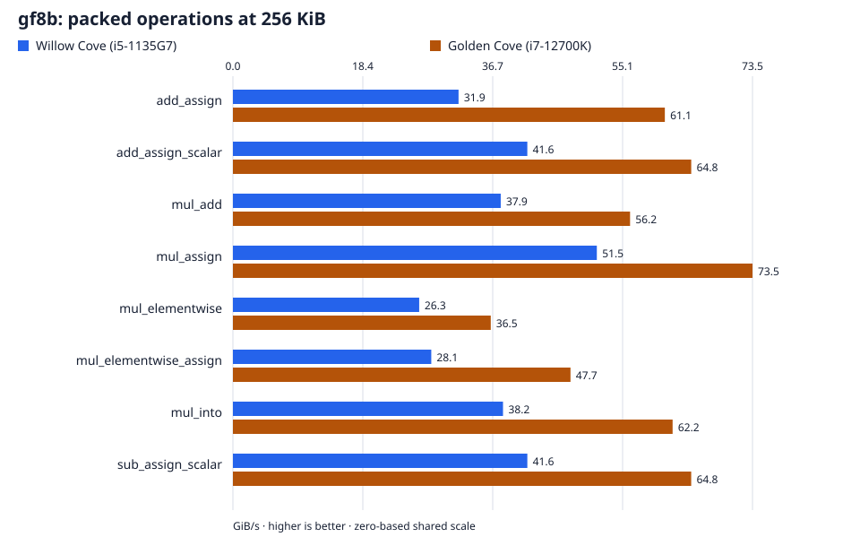

# Byte fields: `gf8b`, `gf8d`

Every result cell reports **Willow Cove (i5-1135G7) / Golden Cove (i7-12700K)**. Throughput: higher is better. Latency: lower is better. A dash means no measurement.

[All families](../../BENCHMARKS.md) · [Field definitions](../labels.md)

## Find a result

- [Scalar multiplication](#scalar-multiplication)
- [Packed operations](#packed-operations)
- [Aligned single-row operations](#aligned-single-row-operations)
- [One-shot and prepared multiplication](#one-shot-and-prepared-multiplication)
- [Scatter, gather, and matrix](#scatter-gather-and-matrix)
- [Aligned gather](#aligned-gather)
- [Overwrite matrix](#overwrite-matrix)
- [Row-wise addition](#row-wise-addition)
- [Row-wise addition compositions](#row-wise-addition-compositions)
- [Network-size payloads](#network-size-payloads)
- [Fixed-offset multi-row operations](#fixed-offset-multi-row-operations)
- [Fixed-offset single-row multiplication](#fixed-offset-single-row-multiplication)
- [Scatter destination alignment](#scatter-destination-alignment)
- [In-place scaling by buffer size](#in-place-scaling-by-buffer-size)
- [Byte-field density control](#byte-field-density-control)
- [Large destinations](#large-destinations)
- [Competitors](#competitors)
- [Measurement details](#measurement-details)

## At a glance

Packed operations at **256 KiB**, ordinary buffers. Both hosts share a linear scale starting at zero. Exact figures and all measured sizes follow under Packed operations.

## Self-timings

### Scalar multiplication

Latency of the dependent multiply chain, per scalar operation.

| Field | Operation | scalar mul (ns/op) |
| --- | --- | --- |
| gf8b | scalar mul | 6.68 / 4.07 |
| gf8d | scalar mul | 6.68 / 4.08 |

### Packed operations

`gf8b`, ordinary `Vec<u8>` buffers.

| Operation | 4 KiB (GiB/s) | 256 KiB (GiB/s) | 8 MiB (GiB/s) |
| --- | --- | --- | --- |
| add_assign | 51.7 / 94.2 | 31.9 / 61.1 | 7.63 / 10.3 |
| add_assign_scalar | 42.0 / 77.1 | 41.6 / 64.8 | 28.5 / 24.7 |
| mul_add | 65.2 / 81.6 | 37.9 / 56.2 | 8.54 / 17.5 |
| mul_assign | 126 / 167 | 51.5 / 73.5 | 30.7 / 27.9 |
| mul_elementwise | 58.8 / 98.5 | 26.3 / 36.5 | 5.26 / 7.12 |
| mul_elementwise_assign | 62.0 / 111 | 28.1 / 47.7 | 7.43 / 9.56 |
| mul_into | 83.0 / 163 | 38.2 / 62.2 | 5.28 / 27.4 |
| sub_assign_scalar | 41.6 / 77.1 | 41.6 / 64.8 | 28.5 / 24.8 |

### Aligned single-row operations

64-byte-aligned buffers.

| Field | Operation | 64 KiB (GiB/s) | 4 MiB (GiB/s) |
| --- | --- | --- | --- |
| gf8b | mul_add | 40.6 / 62.0 | - |
| gf8b | mul_elementwise | 28.9 / 52.0 | - |
| gf8b | mul_elementwise_assign | 40.7 / 63.1 | - |
| gf8b | mul_into | 39.7 / 62.0 | - |
| gf8d | mul_add | 40.7 / 62.1 | - |
| gf8d | mul_elementwise | 28.6 / 47.6 | - |
| gf8d | mul_elementwise_assign | 40.8 / 54.4 | - |
| gf8d | mul_into | 39.7 / 62.0 | 18.2 / 40.0 |

### One-shot and prepared multiplication

Latency per call. The one-shot form derives the backend coefficient on every call; the prepared form reuses coefficients built outside the timed region.

| Row size | mul_add (ns/op) | mul_add_with (ns/op) |
| --- | --- | --- |
| 16 B | 10.75 / 4.271 | 10.34 / 3.859 |
| 32 B | 10.70 / 4.268 | 10.14 / 3.850 |
| 64 B | 10.68 / 4.278 | 10.06 / 4.073 |
| 128 B | 12.66 / 5.120 | 12.37 / 4.698 |
| 256 B | 12.50 / 6.189 | 11.97 / 5.774 |
| 512 B | 16.32 / 8.222 | 16.40 / 8.259 |
| 1 KiB | 21.00 / 14.02 | 21.12 / 13.93 |
| 2 KiB | 29.93 / 24.85 | 30.58 / 24.77 |
| 4 KiB | 61.30 / 46.99 | 61.25 / 46.99 |
| 16 KiB | 208.4 / 177.0 | 208.5 / 177.0 |
| 64 KiB | 1633 / 1092 | 1633 / 1092 |

### Scatter, gather, and matrix

64 KiB rows, ordinary `Vec<u8>` buffers. The column count is destinations for scatter and matrix, sources for gather.

| Operation | 2 rows (GiB/s) | 4 rows (GiB/s) | 8 rows (GiB/s) | 16 rows (GiB/s) |
| --- | --- | --- | --- | --- |
| mul_add_gather | 45.2 / 70.7 | 44.4 / 76.7 | 45.7 / 66.3 | 45.0 / 62.2 |
| mul_add_gather_with | 45.1 / 70.5 | 44.5 / 76.1 | 45.7 / 66.3 | 45.0 / 61.7 |
| mul_add_matrix | 89.7 / 102 | 134 / 141 | 128 / 140 | 123 / 137 |
| mul_add_matrix_with | 90.0 / 102 | 133 / 140 | 127 / 140 | 122 / 137 |
| mul_add_scatter | 45.3 / 66.8 | 48.3 / 69.1 | 48.3 / 69.2 | 46.1 / 48.0 |
| mul_add_scatter_with | 45.3 / 66.9 | 48.3 / 69.1 | 48.3 / 69.2 | 46.1 / 48.2 |

### Aligned gather

Sixteen sources into one row, 64-byte-aligned buffers. `mul_into_gather` is the raw one-shot overwrite form.

| Field | Operation | 4 KiB (GiB/s) | 16 KiB (GiB/s) |
| --- | --- | --- | --- |
| gf8b | mul_into_gather_with | 91.0 / 83.4 | 104 / 85.6 |
| gf8d | mul_add_gather_with | 98.0 / 87.1 | 102 / 89.2 |
| gf8d | mul_into_gather | 91.3 / 101 | 104 / 108 |
| gf8d | mul_into_gather_with | 88.8 / 101 | 103 / 107 |

### Overwrite matrix

Ten sources, 64 KiB rows, 64-byte-aligned buffers. The `fill(0)` cases include clearing the destination; `mul_add_matrix_at` uses contiguous row offsets.

| Field | Operation | 2 destinations (GiB/s) | 4 destinations (GiB/s) | 6 destinations (GiB/s) |
| --- | --- | --- | --- | --- |
| gf8b | fill(0) + mul_add_matrix | 57.4 / 50.1 | 31.1 / 27.8 | 19.4 / 19.6 |
| gf8b | mul_add_matrix_at | 74.4 / 58.4 | 39.5 / 31.2 | 24.2 / 22.3 |
| gf8b | mul_add_matrix_with | 74.2 / 58.5 | 39.8 / 31.0 | 25.1 / 21.9 |
| gf8b | mul_into_matrix | 76.3 / 66.0 | 42.6 / 36.5 | 26.0 / 25.3 |
| gf8b | mul_into_matrix_with | 76.4 / 67.5 | 42.4 / 36.1 | 26.2 / 25.2 |
| gf8d | fill(0) + mul_add_matrix | 57.4 / 52.3 | 31.5 / 34.5 | 19.8 / 22.5 |
| gf8d | mul_into_matrix | 76.5 / 68.6 | 42.8 / 39.3 | 26.3 / 28.4 |

### Row-wise addition

`gf8b`; columns give the size of each row. Flat addition and the per-row loop use the same geometry.

| Operation | Rows | 64 B (GiB/s) | 1 KiB (GiB/s) | 64 KiB (GiB/s) |
| --- | --- | --- | --- | --- |
| add_assign_rows | 1 | 7.13 / 12.7 | 44.8 / 78.6 | 31.8 / 60.7 |
| add_assign_rows | 2 | 13.5 / 25.4 | 65.2 / 88.0 | 32.0 / 60.9 |
| add_assign_rows | 4 | 25.4 / 44.7 | 42.7 / 93.2 | 31.9 / 61.1 |
| add_assign_rows | 8 | 25.6 / 69.6 | 81.0 / 124 | 38.0 / 44.1 |
| add_assign_rows | 16 | 44.8 / 78.6 | 84.4 / 127 | 18.8 / 25.7 |
| add_assign_rows | 32 | 65.2 / 88.0 | 34.7 / 63.8 | 18.5 / 24.7 |

### Row-wise addition compositions

Show row-wise addition compositions

`gf8b`; columns give the size of each row. Flat addition and the per-row loop use the same geometry.

| Operation | Rows | 64 B (GiB/s) | 1 KiB (GiB/s) | 64 KiB (GiB/s) |
| --- | --- | --- | --- | --- |
| add_assign | 1 | 7.35 / 12.7 | 52.7 / 83.2 | 31.9 / 60.8 |
| add_assign | 2 | 14.2 / 26.6 | 70.8 / 91.5 | 32.0 / 61.0 |
| add_assign | 4 | 27.4 / 46.5 | 43.2 / 94.2 | 31.9 / 61.1 |
| add_assign | 8 | 30.3 / 70.7 | 82.0 / 131 | 38.0 / 44.3 |
| add_assign | 16 | 52.7 / 83.1 | 84.6 / 134 | 18.8 / 25.6 |
| add_assign | 32 | 70.8 / 91.4 | 34.9 / 64.3 | 18.4 / 24.7 |
| add_assign per row | 1 | 6.76 / 13.3 | 44.3 / 80.8 | 31.9 / 60.8 |
| add_assign per row | 2 | 7.57 / 14.0 | 51.2 / 83.6 | 31.9 / 60.6 |
| add_assign per row | 4 | 8.19 / 13.6 | 45.1 / 83.4 | 31.8 / 60.8 |
| add_assign per row | 8 | 8.54 / 15.7 | 55.7 / 99.5 | 37.9 / 44.4 |
| add_assign per row | 16 | 7.96 / 14.0 | 53.7 / 97.3 | 18.8 / 25.7 |
| add_assign per row | 32 | 8.52 / 15.6 | 33.9 / 62.4 | 18.4 / 24.7 |

### Network-size payloads

gf8b, ordinary `Vec<u8>` buffers; scatter rows use the payload length as the row pitch.

| Operation | 64 B (GiB/s) | 256 B (GiB/s) | 512 B (GiB/s) | 1152 B (GiB/s) |
| --- | --- | --- | --- | --- |
| add_assign | 7.41 / 12.1 | 27.4 / 43.0 | 30.3 / 70.9 | 56.2 / 82.4 |
| mul_add | 4.97 / 13.8 | 21.4 / 39.9 | 33.8 / 59.0 | 54.7 / 71.6 |
| mul_add_scatter (16 rows) | 13.3 / 26.9 | 42.8 / 74.9 | 67.0 / 90.3 | 73.3 / 108 |
| mul_add_scatter (4 rows) | 9.06 / 17.8 | 30.3 / 46.5 | 52.0 / 73.1 | 65.3 / 96.6 |
| mul_assign | 8.09 / 19.9 | 35.6 / 74.4 | 44.5 / 74.5 | 89.1 / 134 |

| Operation | 1168 B (GiB/s) | 1184 B (GiB/s) | 1200 B (GiB/s) | 1216 B (GiB/s) |
| --- | --- | --- | --- | --- |
| add_assign | 56.4 / 98.0 | 56.4 / 83.0 | 69.4 / 97.8 | 58.2 / 83.1 |
| mul_add | 54.9 / 78.5 | 54.5 / 71.1 | 64.9 / 79.4 | 55.2 / 71.3 |
| mul_add_scatter (16 rows) | 66.3 / 96.3 | 71.2 / 111 | 61.0 / 96.3 | 75.2 / 112 |
| mul_add_scatter (4 rows) | 58.9 / 86.8 | 67.1 / 98.1 | 58.7 / 88.0 | 67.2 / 98.8 |
| mul_assign | 90.3 / 137 | 89.1 / 136 | 95.4 / 138 | 89.1 / 135 |

| Operation | 1232 B (GiB/s) | 1248 B (GiB/s) | 1400 B (GiB/s) |
| --- | --- | --- | --- |
| add_assign | 58.7 / 101 | 59.2 / 83.7 | 73.4 / 102 |
| mul_add | 56.1 / 79.1 | 54.6 / 71.6 | 50.5 / 68.1 |
| mul_add_scatter (16 rows) | 66.6 / 96.4 | 70.8 / 113 | 44.4 / 64.6 |
| mul_add_scatter (4 rows) | 60.2 / 89.4 | 67.5 / 99.9 | 42.3 / 57.0 |
| mul_assign | 88.8 / 138 | 88.8 / 133 | 77.5 / 121 |

### Fixed-offset multi-row operations

Show fixed-offset multi-row operations

gf8d; every source and destination base carries the stated offset modulo 64. Scatter has four destinations, gather sixteen sources, matrix ten sources and four destinations.

| Row size | Base offset mod 64 | mul_add_scatter (GiB/s) | mul_add_gather (GiB/s) | mul_add_matrix (GiB/s) |
| --- | --- | --- | --- | --- |
| 1 KiB | 0 | 81.1 / 98.4 | 110 / 111 | 35.5 / 41.5 |
| 1 KiB | 16 | 61.6 / 89.3 | 86.3 / 92.2 | 32.8 / 41.2 |
| 16 KiB | 0 | 47.8 / 69.5 | 92.7 / 89.7 | 40.2 / 45.3 |
| 16 KiB | 16 | 47.8 / 69.8 | 83.3 / 73.0 | 37.7 / 42.6 |
| 2 KiB | 0 | 92.4 / 110 | 122 / 113 | 39.4 / 43.8 |
| 2 KiB | 16 | 88.6 / 102 | 94.7 / 94.1 | 35.8 / 42.9 |
| 256 B | 0 | 33.1 / 47.5 | 70.2 / 81.3 | 26.2 / 29.1 |
| 256 B | 16 | 26.2 / 32.5 | 56.5 / 71.5 | 21.9 / 28.2 |
| 3 KiB | 0 | 97.5 / 117 | 98.4 / 91.0 | 40.9 / 44.5 |
| 3 KiB | 16 | 91.7 / 113 | 60.1 / 75.7 | 36.8 / 42.6 |
| 4 KiB | 0 | 91.1 / 110 | 90.8 / 88.5 | 40.8 / 43.8 |
| 4 KiB | 16 | 84.0 / 106 | 63.3 / 72.0 | 33.8 / 40.4 |
| 512 B | 0 | 54.5 / 79.1 | 96.8 / 98.8 | 29.1 / 36.3 |
| 512 B | 16 | 37.9 / 67.5 | 70.4 / 84.4 | 27.6 / 35.8 |
| 8 KiB | 0 | 93.1 / 115 | 90.4 / 89.3 | 41.8 / 45.6 |
| 8 KiB | 16 | 88.8 / 110 | 74.2 / 72.3 | 36.8 / 42.8 |

### Fixed-offset single-row multiplication

Show fixed-offset single-row multiplication

gf8d `mul_add`, 16 KiB; source and destination start at the stated offset from a 64-byte boundary.

| Base offset mod 64 | mul_add (GiB/s) |
| --- | --- |
| 0 | 98.0 / 95.1 |
| 16 | 97.7 / 95.2 |
| 32 | 98.2 / 95.1 |
| 48 | 98.1 / 95.3 |

### Scatter destination alignment

Show scatter destination alignment

Eight destinations, ordinary `Vec<u8>` source; the destination starts at the stated offset from a 64-byte boundary.

| Row size | Destination offset mod 64 | mul_add_scatter (GiB/s) |
| --- | --- | --- |
| 256 KiB | 0 | 29.5 / 29.9 |
| 256 KiB | 16 | 29.5 / 22.9 |
| 64 KiB | 0 | 48.5 / 69.4 |
| 64 KiB | 16 | 48.3 / 69.3 |

gf8d, one source and four 16 KiB destination rows, 64-byte-aligned buffers; raw coefficients against prepared coefficients through the plan.

| Operation | Throughput (GiB/s) |
| --- | --- |
| mul_add_scatter | 48.5 / 70.4 |
| mul_add_scatter_with | 48.6 / 70.7 |

### In-place scaling by buffer size

Show in-place scaling by buffer size

`mul_assign`, 64-byte-aligned buffers.

| Field | Buffer size | mul_assign (GiB/s) |
| --- | --- | --- |
| gf8b | 1 MiB | 48.4 / 51.7 |
| gf8b | 16 KiB | 138 / 179 |
| gf8b | 256 KiB | 51.5 / 73.5 |
| gf8b | 4 KiB | 128 / 166 |
| gf8b | 64 KiB | 51.3 / 73.2 |
| gf8d | 1 MiB | 49.2 / 50.5 |
| gf8d | 16 KiB | 138 / 178 |
| gf8d | 256 KiB | 51.5 / 68.0 |
| gf8d | 4 KiB | 128 / 165 |
| gf8d | 64 KiB | 51.4 / 66.0 |

### Byte-field density control

Show byte-field density control

`gf8b` byte-per-element density control measured alongside the bit-packed buffers.

| Buffer size | add_assign (GiB/s) |
| --- | --- |
| 256 KiB | 41.4 / 63.4 |
| 4 KiB | 43.3 / 101 |
| 64 MiB | 6.06 / 14.5 |
| 8 MiB | 8.35 / 24.4 |

### Large destinations

Show large destinations

Ordinary `Vec<u8>` buffers. The read-back row XOR-folds every written 64-bit word after `mul_into`.

| Buffer size | mul_into (GiB/s) | mul_into + read (GiB/s) | mul_add (GiB/s) |
| --- | --- | --- | --- |
| 1 MiB | 18.8 / 25.8 | 13.7 / 20.3 | 18.8 / 26.2 |
| 32 MiB | 9.37 / 27.6 | 5.97 / 14.1 | 6.22 / 16.2 |
| 8 MiB | 18.2 / 40.0 | 7.74 / 16.2 | 8.11 / 24.6 |

## Competitors

Polynomial `0x11D`, page-aligned buffers, and matched coding coefficients. ISA-L uses its field kernels; klauspost uses `Encode` with a supplied coding matrix, or `EncodeIdx` for accumulation. Outputs are validated before timing.

| Operation | Sources × destinations | Row size | `fgf` (GiB/s) | Intel ISA-L (GiB/s) | klauspost/reedsolomon (GiB/s) |
| --- | --- | --- | --- | --- | --- |
| dst = c * src | 1 × 1 | 64 KiB | 40.1 / 62.0 | 18.0 / 43.8 | 33.7 / 54.5 |
| dst ^= c * src | 1 × 1 | 64 KiB | 40.9 / 62.1 | 41.2 / 62.5 | 29.1 / 47.0 |
| dst = sum(c[i] * src[i]) | 16 × 1 | 4 KiB | 90.8 / 98.8 | 83.1 / 99.9 | 30.6 / 47.7 |
| dst = sum(c[i] * src[i]) | 16 × 1 | 16 KiB | 96.5 / 93.9 | 75.0 / 91.1 | 35.6 / 54.4 |
| systematic encode | 10 × 2 | 4 KiB | 76.2 / 73.3 | 65.6 / 71.1 | 52.8 / 72.0 |
| systematic encode | 10 × 4 | 4 KiB | 39.6 / 45.6 | 35.9 / 42.5 | 31.9 / 42.7 |
| systematic encode | 10 × 6 | 4 KiB | 26.8 / 31.4 | 24.5 / 29.9 | 22.5 / 29.0 |
| systematic encode | 10 × 2 | 16 KiB | 81.7 / 81.0 | 53.0 / 66.3 | 67.5 / 81.4 |
| systematic encode | 10 × 4 | 16 KiB | 42.9 / 48.8 | 36.6 / 37.9 | 38.7 / 48.3 |
| systematic encode | 10 × 6 | 16 KiB | 27.2 / 33.1 | 24.9 / 29.2 | 25.8 / 32.9 |
| systematic encode | 10 × 2 | 64 KiB | 84.0 / 76.0 | 54.1 / 65.8 | 73.6 / 83.5 |
| systematic encode | 10 × 4 | 64 KiB | 43.4 / 48.6 | 35.9 / 33.3 | 40.6 / 45.6 |
| systematic encode | 10 × 6 | 64 KiB | 27.1 / 32.6 | 24.0 / 23.1 | 26.6 / 29.4 |

## Measurement details

Setup, resolved backends, versions, and caveats

| Setting | Value |
| --- | --- |
| Campaign | `just bench-paired` |
| Revision | `63b8d168a7e4b81043fafe4db1ffb9918dc1c231` plus the measured working-tree archive |
| Toolchain | 1.98.1 |
| Willow Cove (i5-1135G7) process | `v4x` |
| Golden Cove (i7-12700K) process | `v3_gfni_crypto` |
| `gf8b` backend | `v4x` / `v3_gfni_crypto` |
| `gf8d` backend | `v4x` / `v3_gfni_crypto` |
| Aggregation | Median of five per-run medians. |
| Throughput | Logical bytes divided by aggregate latency per call; numerators are stated per panel. |
| Competitors | Willow Cove (i5-1135G7): Intel ISA-L 2.32.0; klauspost/reedsolomon v1.14.2 via Go go1.27.1-X:nodwarf5 linux/amd64; Golden Cove (i7-12700K): Intel ISA-L 2.32.0; klauspost/reedsolomon v1.14.2 via Go go1.27.1-X:nodwarf5 linux/amd64 |

- The unchanged byte-XOR control brackets every self-suite process; its values are retained in the raw evidence.
- The trio harness opens with an all-`fgf` control row; control values are retained in the raw evidence.

