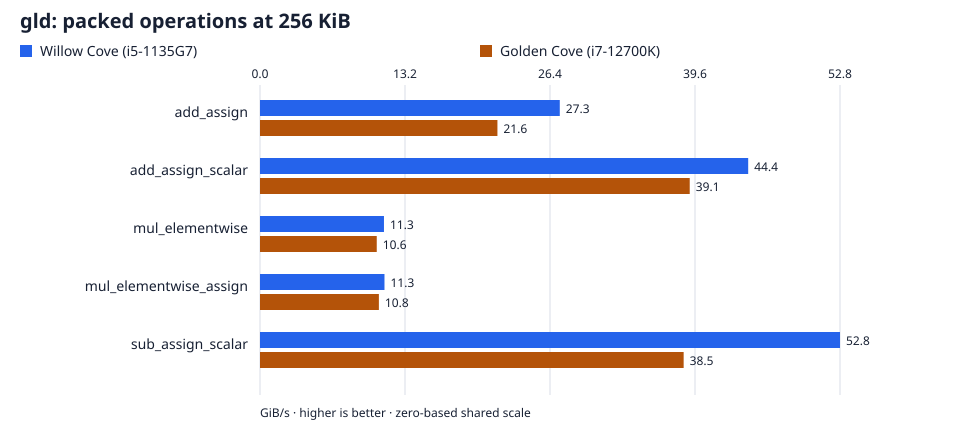

# Goldilocks: `gld`

Every result cell reports **Willow Cove (i5-1135G7) / Golden Cove (i7-12700K)**. Throughput: higher is better. Latency: lower is better. A dash means no measurement.

[All families](../../BENCHMARKS.md) · [Field definitions](../labels.md)

## Find a result

- [Packed operations](#packed-operations)
- [Competitors](#competitors)
- [Measurement details](#measurement-details)

## At a glance

Packed operations at **256 KiB**, ordinary buffers. Both hosts share a linear scale starting at zero. Exact figures and all measured sizes follow under Packed operations.

## Self-timings

### Packed operations

`gld`, ordinary `Vec<u8>` buffers.

| Operation | 4 KiB (GiB/s) | 256 KiB (GiB/s) | 8 MiB (GiB/s) |
| --- | --- | --- | --- |
| add_assign | 29.7 / 21.1 | 27.3 / 21.6 | 8.16 / 20.3 |
| add_assign_scalar | 45.2 / 39.7 | 44.4 / 39.1 | 25.8 / 32.3 |
| mul_elementwise | 10.8 / 10.2 | 11.3 / 10.6 | 5.17 / 10.1 |
| mul_elementwise_assign | 11.0 / 10.7 | 11.3 / 10.8 | 7.19 / 9.49 |
| sub_assign_scalar | 60.0 / 39.2 | 52.8 / 38.5 | 27.8 / 32.5 |

## Competitors

Page-aligned regions on each library's native layout; conversions are excluded. Packed throughput counts two region byte extents per call. Scalar rows measure indexed products with accumulation. Arms alternate within one process, and outputs are validated before timing.

### Scalar

| Field | Operation | `fgf` (ns/op) | Plonky3 (ns/op) |
| --- | --- | --- | --- |
| gld | scalar a * b | 4.48 / 2.13 | 2.57 / 1.16 |

### Packed

| Field | Operation | `fgf` (GiB/s) | Plonky3 (GiB/s) |
| --- | --- | --- | --- |
| gld | dst += c * src | 19.7 / 16.3 | 22.5 / 19.7 |
| gld | dst += v | 97.5 / 78.1 | 103 / 142 |
| gld | dst -= v | 103 / 77.6 | 103 / 142 |
| gld | dst = a * b | 23.8 / 22.4 | 26.8 / 25.5 |
| gld | dst = c * src | 25.1 / 22.8 | 27.5 / 26.0 |

## Measurement details

Setup, resolved backends, versions, and caveats

| Setting | Value |
| --- | --- |
| Campaign | `just bench-paired` |
| Revision | `63b8d168a7e4b81043fafe4db1ffb9918dc1c231` plus the measured working-tree archive |
| Toolchain | 1.98.1 |
| Willow Cove (i5-1135G7) process | `v4x` |
| Golden Cove (i7-12700K) process | `v3_gfni_crypto` |
| `gld` backend | `v4x` / `v3` |
| Aggregation | Median of five per-run medians. |
| Throughput | Logical bytes divided by aggregate latency per call; numerators are stated per panel. |
| Competitors | Willow Cove (i5-1135G7): Plonky3 0.7.0; gld: 8 lanes; Golden Cove (i7-12700K): Plonky3 0.7.0; gld: 4 lanes |

- The unchanged byte-XOR control brackets every self-suite process; its values are retained in the raw evidence.
- The prime harness control values are retained in the raw evidence.

