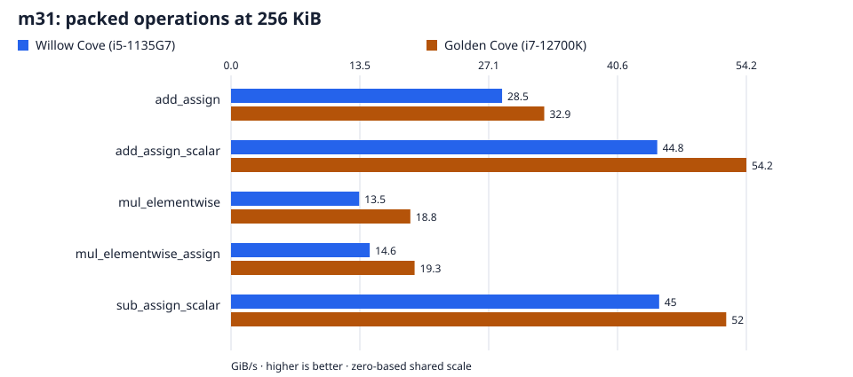
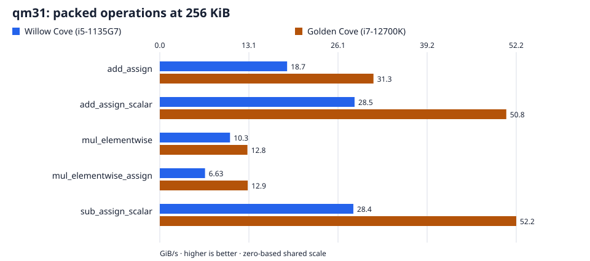

# Mersenne fields: `m31`, `qm31`

Every result cell reports **Willow Cove (i5-1135G7) / Golden Cove (i7-12700K)**. Throughput: higher is better. Latency: lower is better. A dash means no measurement.

[All families](../../BENCHMARKS.md) · [Field definitions](../labels.md)

## Find a result

- [Packed operations](#packed-operations)
- [Row-wise addition](#row-wise-addition)
- [Row-wise addition compositions](#row-wise-addition-compositions)
- [Competitors](#competitors)
- [Measurement details](#measurement-details)

## At a glance

Packed operations at **256 KiB**, ordinary buffers. Both hosts share a linear scale starting at zero. Exact figures and all measured sizes follow under Packed operations.

## Self-timings

### Packed operations

`m31`, ordinary `Vec<u8>` buffers.

| Operation | 4 KiB (GiB/s) | 256 KiB (GiB/s) | 8 MiB (GiB/s) |
| --- | --- | --- | --- |
| add_assign | 29.3 / 33.9 | 28.5 / 32.9 | 7.98 / 20.5 |
| add_assign_scalar | 44.1 / 54.8 | 44.8 / 54.2 | 25.5 / 21.1 |
| mul_elementwise | 14.5 / 18.8 | 13.5 / 18.8 | 5.29 / 17.6 |
| mul_elementwise_assign | 15.2 / 19.4 | 14.6 / 19.3 | 7.71 / 19.4 |
| sub_assign_scalar | 44.3 / 54.8 | 45.0 / 52.0 | 25.5 / 21.1 |

`qm31`, ordinary `Vec<u8>` buffers.

| Operation | 4 KiB (GiB/s) | 256 KiB (GiB/s) | 8 MiB (GiB/s) |
| --- | --- | --- | --- |
| add_assign | 19.4 / 32.2 | 18.7 / 31.3 | 7.81 / 24.0 |
| add_assign_scalar | 33.1 / 53.4 | 28.5 / 50.8 | 20.4 / 24.4 |
| mul_elementwise | 10.4 / 13.0 | 10.3 / 12.8 | 5.23 / 12.6 |
| mul_elementwise_assign | 6.75 / 13.1 | 6.63 / 12.9 | 6.33 / 12.2 |
| sub_assign_scalar | 32.9 / 53.4 | 28.4 / 52.2 | 20.3 / 24.5 |

### Row-wise addition

`m31`; columns give the size of each row. Flat addition and the per-row loop use the same geometry.

| Operation | Rows | 64 B (GiB/s) | 1 KiB (GiB/s) | 64 KiB (GiB/s) |
| --- | --- | --- | --- | --- |
| add_assign_rows | 1 | 5.51 / 11.6 | 25.5 / 32.4 | 28.2 / 33.0 |
| add_assign_rows | 2 | 8.68 / 18.4 | 26.4 / 35.1 | 29.6 / 36.9 |
| add_assign_rows | 4 | 16.4 / 24.3 | 28.7 / 33.5 | 26.1 / 35.1 |
| add_assign_rows | 8 | 24.4 / 29.1 | 29.9 / 34.2 | 25.3 / 29.7 |
| add_assign_rows | 16 | 25.5 / 32.4 | 30.6 / 34.5 | 18.6 / 21.8 |
| add_assign_rows | 32 | 26.4 / 35.1 | 30.0 / 32.7 | 18.1 / 20.8 |

### Row-wise addition compositions

Show row-wise addition compositions

`m31`; columns give the size of each row. Flat addition and the per-row loop use the same geometry.

| Operation | Rows | 64 B (GiB/s) | 1 KiB (GiB/s) | 64 KiB (GiB/s) |
| --- | --- | --- | --- | --- |
| add_assign | 1 | 7.31 / 12.1 | 29.1 / 32.9 | 28.3 / 32.9 |
| add_assign | 2 | 11.7 / 19.1 | 27.7 / 35.4 | 29.7 / 36.9 |
| add_assign | 4 | 20.4 / 26.1 | 29.3 / 33.9 | 26.1 / 35.0 |
| add_assign | 8 | 29.8 / 29.9 | 30.3 / 34.3 | 25.2 / 29.5 |
| add_assign | 16 | 29.1 / 32.8 | 30.8 / 34.7 | 18.6 / 21.6 |
| add_assign | 32 | 27.7 / 35.4 | 30.2 / 33.0 | 18.1 / 20.8 |
| add_assign per row | 1 | 6.14 / 11.1 | 26.4 / 33.0 | 28.3 / 32.9 |
| add_assign per row | 2 | 7.34 / 13.0 | 28.8 / 33.8 | 29.5 / 36.8 |
| add_assign per row | 4 | 8.29 / 14.1 | 29.6 / 31.7 | 26.0 / 35.0 |
| add_assign per row | 8 | 8.80 / 14.8 | 29.9 / 31.7 | 25.1 / 31.4 |
| add_assign per row | 16 | 7.94 / 15.2 | 29.4 / 31.4 | 18.6 / 21.5 |
| add_assign per row | 32 | 8.45 / 14.7 | 28.3 / 30.5 | 18.1 / 20.6 |

## Competitors

Page-aligned regions on each library's native layout; conversions are excluded. Packed throughput counts two region byte extents per call. Scalar rows measure indexed products with accumulation. Arms alternate within one process, and outputs are validated before timing.

### Scalar

| Field | Operation | `fgf` (ns/op) | Plonky3 (ns/op) |
| --- | --- | --- | --- |
| m31 | scalar a * b | 4.201 / 1.611 | 2.098 / 0.837 |
| qm31 | scalar a * b | 16.22 / 6.785 | 7.089 / 3.036 |

### Packed

| Field | Operation | `fgf` (GiB/s) | Plonky3 (GiB/s) |
| --- | --- | --- | --- |
| m31 | dst += c * src | 32.8 / 36.0 | 49.8 / 54.7 |
| m31 | dst += v | 98.5 / 117 | 103 / 147 |
| m31 | dst -= v | 98.5 / 116 | 103 / 146 |
| m31 | dst = a * b | 34.8 / 39.5 | 59.9 / 66.5 |
| m31 | dst = c * src | 50.3 / 51.4 | 65.4 / 69.7 |
| qm31 | dst += c * src | 21.4 / 24.0 | 27.0 / 30.4 |
| qm31 | dst += v | 68.1 / 117 | 103 / 147 |
| qm31 | dst -= v | 67.7 / 116 | 103 / 147 |
| qm31 | dst = a * b | 23.9 / 27.3 | 24.1 / 25.1 |
| qm31 | dst = c * src | 29.2 / 32.9 | 30.5 / 34.7 |

## Measurement details

Setup, resolved backends, versions, and caveats

| Setting | Value |
| --- | --- |
| Campaign | `just bench-paired` |
| Revision | `63b8d168a7e4b81043fafe4db1ffb9918dc1c231` plus the measured working-tree archive |
| Toolchain | 1.98.1 |
| Willow Cove (i5-1135G7) process | `v4x` |
| Golden Cove (i7-12700K) process | `v3_gfni_crypto` |
| `m31` backend | `v4x` / `v3` |
| `qm31` backend | `v4x` / `v3` |
| Aggregation | Median of five per-run medians. |
| Throughput | Logical bytes divided by aggregate latency per call; numerators are stated per panel. |
| Competitors | Willow Cove (i5-1135G7): Plonky3 0.7.0; m31: 16 lanes, qm31: 16 lanes; Golden Cove (i7-12700K): Plonky3 0.7.0; m31: 8 lanes, qm31: 8 lanes |

- The unchanged byte-XOR control brackets every self-suite process; its values are retained in the raw evidence.
- The prime harness control values are retained in the raw evidence.

